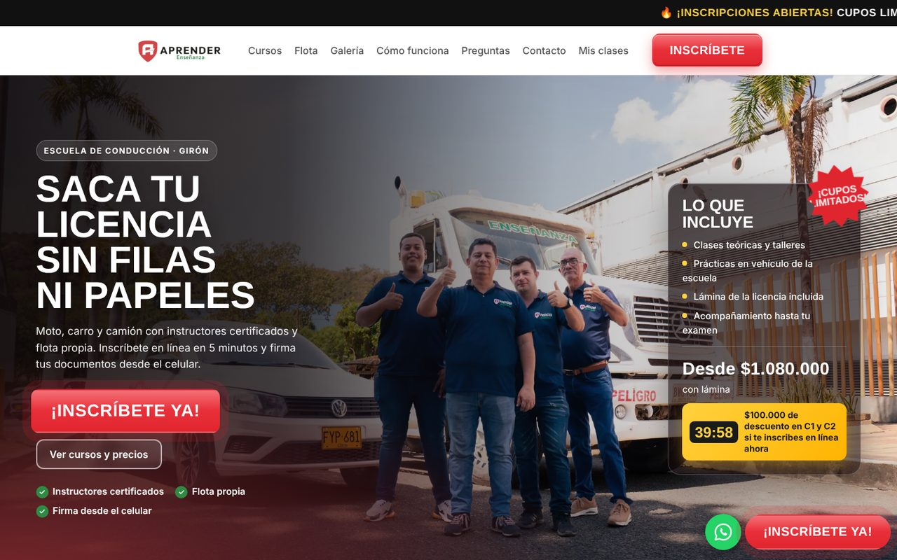
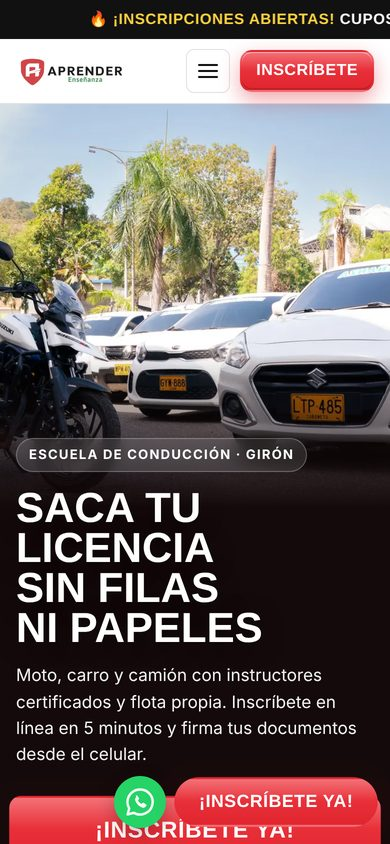
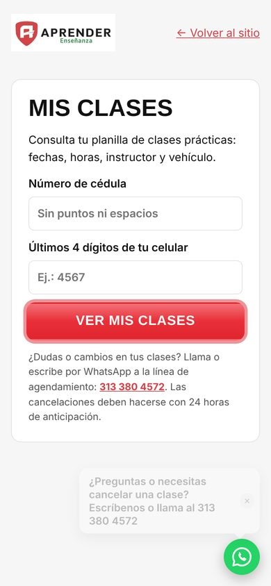
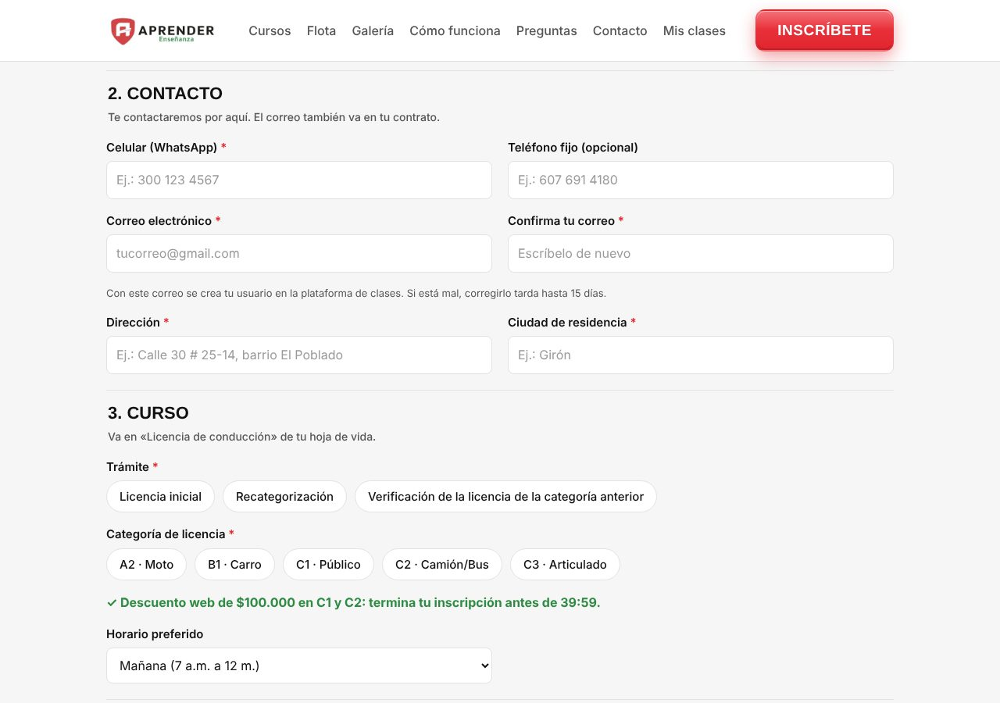

# Case study: a driving school goes from paper and Excel to a real system

**Client:** CEA Aprender, a driving school in Santander, Colombia
**Role:** Sole builder: scoping, design, development, testing and handoff
**Stack:** React + TypeScript (Vite), Supabase (Postgres, Auth, Storage, Edge Functions), Cloudflare, Resend
**Live site:** [aprenderenseñanza.com](https://xn--aprenderenseanza-iub.com)

> The source code is private (it belongs to the client). This page shows what was built and how.

## The problem

The school ran on paper sign-up forms, a printed contract, social media messages and an Excel sheet for the class schedule. Every new student meant manual data entry, lost paperwork and phone calls to find out when their next class was.

## What I built

**1. Online registration with legal e-signatures.** Students fill in the school's official documents on their phone, take a photo, and sign in three places. The form enforces the school's rules: age limits, guardian details for minors, and which license categories each student can choose.

**2. A signed PDF generated automatically.** The system produces the school's hoja de vida and contract in their exact paper format (oficio size), plus a signature record with timestamps and a SHA-256 hash. The PDF is emailed to the student and the school.

**3. An admin panel for staff.** Each staff member has their own account. They search and filter registrations, view documents and photos, add notes, export CSV and download backups.

**4. A class scheduler that replaced the Excel sheet.** A weekly grid of 26 instructors and their vehicles, with 1- and 2-hour classes. It warns about double-booked vehicles, double-booked students and classes after a course expires, keeps a per-student history, and prints the school's planilla.

**5. A self-service portal for students.** Students look up their own class schedule with their ID number and the last digits of their phone, then save it as an image or PDF.

  
  &nbsp;
  

## How it runs

- **Cost:** runs on free tiers (Cloudflare, Supabase, Resend). Current usage fits roughly 5,000 registrations before any paid plan is needed.
- **Reliability:** weekly automated backups, uptime monitoring, and database rules that enforce the business logic (age limits, discounts, document versions) even if the frontend is bypassed.
- **Security:** row-level security on every table, per-user staff accounts, a protected student lookup, and a content security policy.
- **Deploys:** every push to `main` deploys automatically in about two minutes.

## Results

- Registration moved from paper to the student's phone, with documents signed and filed automatically.
- The front desk no longer retypes student data or keeps the class schedule in Excel.
- Students check and save their own schedules instead of calling the school.

---

Need something like this for your business? [automatikz.com](https://www.automatikz.com)
